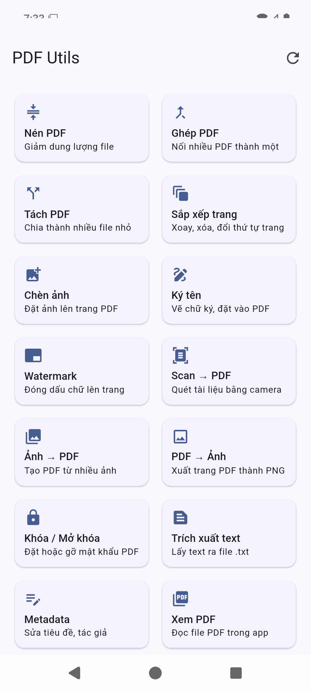
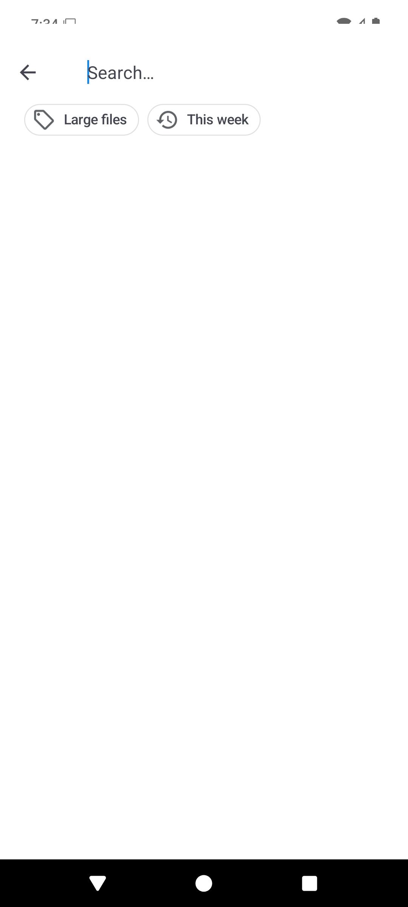
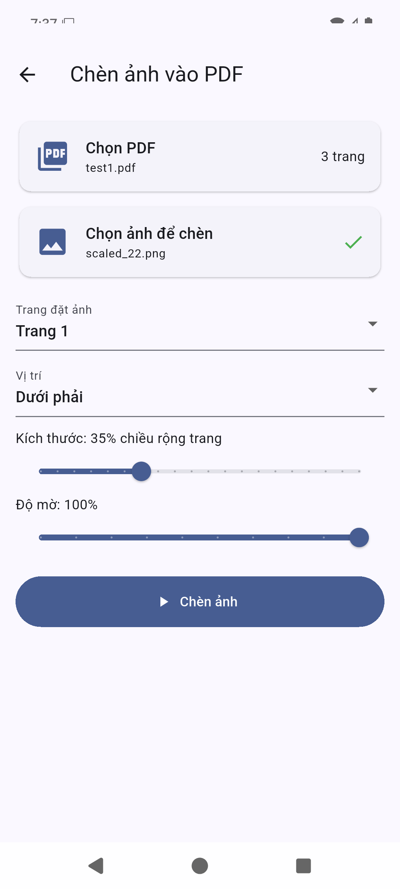
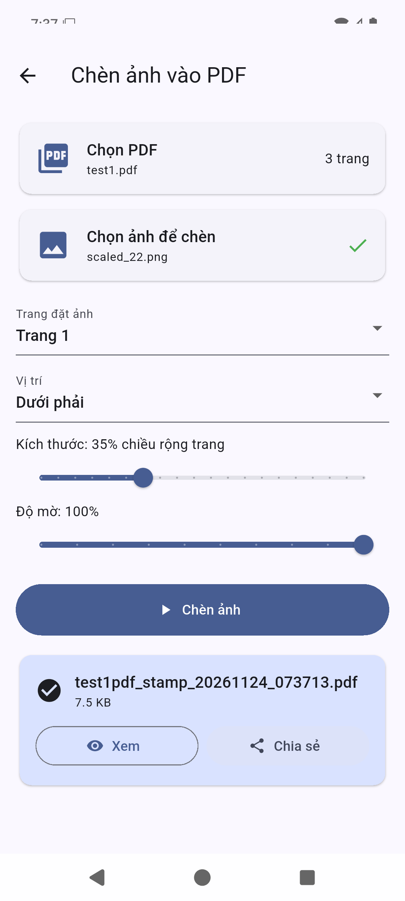
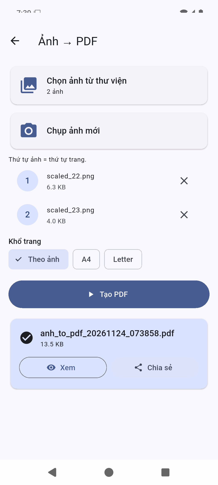

# PDF Utils


**Xử lý mọi vấn đề với file PDF — ngay trên điện thoại. 31 công cụ, miễn phí hoàn toàn.**

PDF Utils là app Flutter cho Android & iOS dành cho dân văn phòng, gom **31 công cụ PDF** vào một nơi: nén, ghép, tách, sửa file lỗi, xóa/trích/xoay/sắp xếp trang, chỉnh sửa (thêm chữ, vẽ, tô sáng), ký tên, đóng dấu chữ, đánh số trang, điền form, scan, chuyển ảnh ↔ PDF, PDF ↔ Word/Excel/PowerPoint, trang web → PDF, PDF/A, nhận dạng chữ (OCR), tóm tắt, dịch, so sánh hai bản, khóa/mở khóa và che nội dung. Mọi xử lý chạy **on-device** bằng engine Rust của [`pdf_manipulator`](https://pub.dev/packages/pdf_manipulator) — không cần server, không tải file lên đâu cả. Chỉ hai việc cần Internet: tải trang web cho **Trang web → PDF**, và tải gói ngôn ngữ lần đầu dùng **Dịch PDF**.



## Mục lục

- [Tính năng](#tính-năng)
- [Ảnh màn hình thật](#ảnh-màn-hình-thật)
- [Kiến trúc](#kiến-trúc)
- [Công nghệ & thư viện](#công-nghệ--thư-viện)
- [Cài đặt & chạy](#cài-đặt--chạy)
- [Quyền truy cập](#quyền-truy-cập)
- [Giấy phép](#giấy-phép)

## Tính năng

31 công cụ chia 6 nhóm như trên màn hình chính. Ô tìm kiếm ở đầu màn hình tìm được cả khi gõ không dấu (vd: `nen`, `ky ten`, `word`).

**Nén, ghép & tách**

| Công cụ | Mô tả |
|---|---|
| **Nén PDF** | Giảm dung lượng với 4 mức: Nhẹ nhất (72ppi/q60), Cân bằng (150ppi/q75), Chất lượng cao (300ppi/q85), Không mất chất lượng (lossless) |
| **Ghép PDF** | Nối nhiều PDF thành một, sắp thứ tự trước khi ghép |
| **Tách PDF** | Chia theo mỗi N trang / từng trang / giới hạn MB mỗi file |
| **Sửa PDF lỗi** | Dựng lại file hỏng (bảng tham chiếu sai, mất phần cuối file) rồi lưu thành PDF sạch |

**Trang**

| Công cụ | Mô tả |
|---|---|
| **Sắp xếp trang** | Kéo-thả đổi thứ tự, xoay 90°, xóa trang — có thumbnail preview |
| **Xóa trang** | Chạm chọn trang trên lưới thumbnail rồi xóa |
| **Trích trang** | Chạm chọn trang để lấy ra thành file mới |
| **Xoay PDF** | Xoay mọi trang (phải / trái / lật ngược), nhiều file một lúc |
| **Cắt lề trang** | Bớt lề trái/phải/trên/dưới (mm) — set CropBox |
| **Gộp trang lên 1 tờ** | N-up: 2/4/6/9 trang trên một tờ A4 ngang (raster), tiết kiệm giấy khi in |

**Chỉnh sửa & ký**

| Công cụ | Mô tả |
|---|---|
| **Chỉnh sửa PDF** | Thêm chữ, vẽ tay, đóng khung, tô sáng; hoàn tác; sửa nhiều trang rồi lưu một lần |
| **Ký tên** | Vẽ chữ ký trên pad hoặc chọn từ thư viện chữ ký đã lưu (lưu/xóa nhiều chữ ký), đặt vào PDF như ảnh chèn |
| **Chèn ảnh** | Đặt ảnh lên trang PDF: chọn trang, góc đặt, kích thước %, độ mờ |
| **Đóng dấu chữ** | Watermark chữ giữa mọi trang (BẢN SAO, MẬT…): màu, chéo/ngang, cỡ, độ đậm, xem trước trên trang đầu |
| **Đánh số trang** | Kiểu `1`, `Trang 1`, `1/10`, `Trang 1/10` hoặc tự nhập; 6 vị trí; bỏ qua trang bìa |
| **Điền form** | Đọc và điền AcroForm: text, checkbox, dropdown, radio |

**Chuyển đổi**

| Công cụ | Mô tả |
|---|---|
| **Scan → PDF** | Quét tài liệu bằng camera (ML Kit document scanner), fallback chụp ảnh thường |
| **Ảnh → PDF** | Tạo PDF từ nhiều ảnh; trang theo ảnh / A4 / Letter, fit contain/cover |
| **PDF → Ảnh** | Mỗi trang thành ảnh JPG (nhẹ) hoặc PNG (nét), 3 mức nét; hoặc lấy nguyên các ảnh có sẵn trong file |
| **PDF ↔ Word, Excel, PPT** | PDF → Word/Excel/PowerPoint và ngược lại |
| **Trang web → PDF** | Dán link, tải trang web và lưu thành PDF khổ A4 |
| **PDF/A (lưu trữ)** | Chuyển sang PDF/A-2b (chuẩn lưu trữ, nộp hồ sơ điện tử) và kiểm tra lại |

**Đọc & hiểu**

| Công cụ | Mô tả |
|---|---|
| **Xem PDF** | Đọc PDF trong app (flutter_pdfview), đếm trang, chia sẻ |
| **Trích xuất chữ** | Lấy toàn bộ chữ ra file `.txt` hoặc Markdown `.md` |
| **Nhận dạng chữ (OCR)** | Lấy chữ từ ảnh chụp hoặc PDF bản scan (ML Kit on-device), copy hoặc lưu `.txt` |
| **Tóm tắt PDF** | Chọn ra 5 / 10 / 20 câu quan trọng nhất trong file (TextRank, chạy trên máy) |
| **Dịch PDF** | Dịch giữa tiếng Việt, Anh, Trung, Nhật, Hàn bằng ML Kit on-device |
| **So sánh PDF** | So bản cũ với bản mới theo từng từ, chỉ ra chỗ thêm và chỗ xóa; bỏ qua đầu/chân trang lặp lại |

Tóm tắt, Dịch và So sánh tự nhận dạng chữ khi gặp PDF bản scan, không cần chạy OCR riêng trước.

**Bảo mật**

| Công cụ | Mô tả |
|---|---|
| **Khóa / Mở khóa** | Đặt mật khẩu (AES) hoặc gỡ mật khẩu PDF |
| **Che nội dung** | Redaction thật — kéo vùng trên trang để xóa vĩnh viễn text/ảnh bên dưới |
| **Thông tin file** | Sửa tiêu đề, tác giả, chủ đề, từ khóa (metadata) của PDF |

**Miễn phí hoàn toàn** — cả 31 công cụ đều dùng được ngay: không quảng cáo, không mua trong app, xử lý hoàn toàn trên máy.

### Giới hạn

- **Nhận dạng chữ** trả về chữ (`.txt`), chưa tạo được PDF có lớp chữ tìm kiếm được: font PDF có sẵn của engine không viết được tiếng Việt.
- **Dịch PDF** giữ nội dung, không giữ bố cục trang. **Tóm tắt** chọn câu có sẵn trong file, không viết lại như AI tạo sinh.
- **So sánh PDF** chỉ so phần chữ, không so hình ảnh.
- Chưa tạo được ô form mới trên PDF có sẵn (chỉ điền form có sẵn): engine chưa có API thêm field.

## Ảnh màn hình thật

Chụp từ Android emulator chạy build debug thật. Ảnh chụp trước đợt đổi giao diện navy & xám bạc, nên màu sắc và bố cục màn hình chính đã khác:

| Ghép PDF | Kết quả ghép (5 trang, đúng thứ tự) |
|---|---|
|  |  |

| Nén PDF (1.2 KB → 782 B) | Chèn ảnh (tùy chọn) | Kết quả chèn ảnh |
|---|---|---|
|  |  |  |

| Xem PDF trong app | Ảnh → PDF |
|---|---|
|  |  |

## Kiến trúc

```
lib/
├── main.dart              # MaterialApp, light/dark theo hệ thống
├── theme.dart             # Giao diện navy & xám bạc, font Be Vietnam Pro
├── engine.dart            # PdfEngine — wrapper mỏng quanh pdf_manipulator (Rust engine)
├── page_overlay.dart      # Vẽ chữ/hình bằng Flutter → PNG, tọa độ trang (kể cả trang xoay)
├── files.dart             # outputs dir, file picker, image picker, content:// resolver
├── diacritics.dart        # Bỏ dấu / chuẩn hóa dấu tiếng Việt (tên file, tìm kiếm, so sánh)
├── page_text.dart         # Tách / ghép trang, bỏ đầu–chân trang lặp lại
├── pdf_ocr.dart           # Nhận dạng chữ cho PDF bản scan (ML Kit)
├── errors.dart            # Thông báo lỗi bằng tiếng Việt dễ hiểu
├── text_diff.dart         # So sánh văn bản theo từng từ
├── summarizer.dart        # Tóm tắt trích câu (TextRank)
├── widgets.dart           # IconTile / PickTile / RunButton / ResultCard / ErrorBanner
├── home_screen.dart       # 31 công cụ chia 6 nhóm + ô tìm kiếm + danh sách "File đã tạo"
├── viewer_screen.dart     # Xem PDF trong app
└── screens/               # Một màn hình cho mỗi công cụ
    ├── compress_screen.dart
    ├── merge_screen.dart
    ├── split_screen.dart
    ├── repair_screen.dart       # sửa PDF lỗi
    ├── pages_screen.dart        # sắp xếp / xoay / xóa trang với thumbnail
    ├── select_pages_screen.dart # xóa trang / trích trang
    ├── rotate_screen.dart       # xoay PDF
    ├── crop_screen.dart         # cắt lề trang (cropMargins)
    ├── nup_screen.dart          # gộp trang lên 1 tờ: render trang → lưới → PDF
    ├── edit_screen.dart         # thêm chữ / vẽ / khung / tô sáng
    ├── sign_screen.dart         # signature pad → chèn ảnh
    ├── stamp_screen.dart        # chèn ảnh
    ├── watermark_screen.dart    # đóng dấu chữ
    ├── numbering_screen.dart    # đánh số trang
    ├── form_screen.dart         # điền AcroForm
    ├── scan_screen.dart         # ML Kit scan + fallback camera
    ├── images_to_pdf_screen.dart
    ├── pdf_to_images_screen.dart
    ├── office_screen.dart       # PDF ↔ docx/xlsx/pptx
    ├── web_to_pdf_screen.dart   # trang web → PDF
    ├── pdfa_screen.dart         # PDF/A
    ├── text_screen.dart         # trích xuất chữ (.txt / .md)
    ├── ocr_screen.dart          # ML Kit text recognition: ảnh và PDF scan
    ├── summarize_screen.dart    # tóm tắt
    ├── translate_screen.dart    # dịch (ML Kit on-device)
    ├── compare_screen.dart      # so sánh hai bản
    ├── protect_screen.dart      # khóa / mở khóa
    ├── redact_screen.dart       # che nội dung
    └── metadata_screen.dart     # thông tin file
```

Mọi file kết quả nằm ở `<Documents>/pdf_utils/` và xuất hiện trong mục **File đã tạo** trên màn hình chính — Xem / Mở / Chia sẻ trực tiếp.

## Công nghệ & thư viện

- **[pdf_manipulator](https://pub.dev/packages/pdf_manipulator) 6.0.0** — engine Rust chạy off-main-thread: merge, split, compress, rewrite (xoay/sắp xếp/xóa trang, watermark, image stamp, crop, redaction, form fill, metadata), mã hóa AES, render bitmap, trích text, chuyển đổi Office.
- **[flutter_pdfview](https://pub.dev/packages/flutter_pdfview)** — xem PDF trong app.
- **[doc_scanner_kit](https://pub.dev/packages/doc_scanner_kit)** — quét tài liệu (Google ML Kit); có fallback chụp ảnh.
- **[google_mlkit_text_recognition](https://pub.dev/packages/google_mlkit_text_recognition)** — OCR on-device (không cần Play services).
- **[google_mlkit_translation](https://pub.dev/packages/google_mlkit_translation)** — dịch on-device; gói ngôn ngữ tải một lần khi dùng lần đầu.
- **[printing](https://pub.dev/packages/printing)** — dựng trang web thành PDF bằng WebView của hệ thống.
- **[image](https://pub.dev/packages/image)** — ghép lưới trang cho N-up, xuất ảnh JPG.
- **[file_picker](https://pub.dev/packages/file_picker)** / **[image_picker](https://pub.dev/packages/image_picker)** — chọn file / ảnh / camera.
- **[share_plus](https://pub.dev/packages/share_plus)** / **[open_file](https://pub.dev/packages/open_file)** — chia sẻ & mở kết quả.
- **[permission_handler](https://pub.dev/packages/permission_handler)** — quyền camera.
- **[Be Vietnam Pro](https://fonts.google.com/specimen/Be+Vietnam+Pro)** — font giao diện (SIL OFL), đóng gói sẵn trong `assets/fonts/`, không tải qua mạng.

Tất cả thư viện đều mã nguồn mở (MIT/BSD; font theo SIL OFL) và miễn phí.

## Cài đặt & chạy

Yêu cầu: Flutter ≥ 3.47 (Dart 3.13), Android SDK 37 (do `permission_handler` yêu cầu), Xcode cho iOS.

```bash
git clone <repo>
cd pdf-utils
flutter pub get

# Android
flutter build apk --debug        # hoặc flutter run với device/emulator

# iOS (trên macOS)
cd ios && pod install && cd ..
flutter build ios --no-codesign  # hoặc flutter run trên simulator
```

`pdf_manipulator` tự tải binary engine đã build sẵn (~25 MB) qua build hook — không cần cài Rust.

## Quyền truy cập

| Quyền | Dùng cho |
|---|---|
| Camera | Scan tài liệu, chụp ảnh |
| Photo library (iOS) | Chọn ảnh |
| Internet | Trang web → PDF; tải gói ngôn ngữ lần đầu dùng Dịch PDF |

App không cần quyền storage đặc biệt — file chọn qua SAF/photo picker, file kết quả trong thư mục riêng của app.

## Giấy phép

App miễn phí hoàn toàn. Mã nguồn phát hành theo MIT License.
