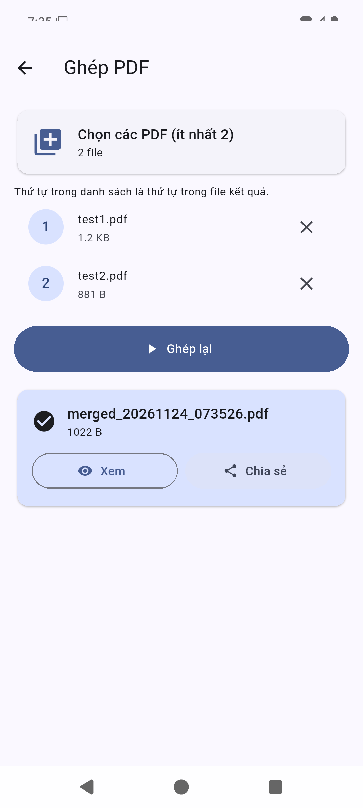
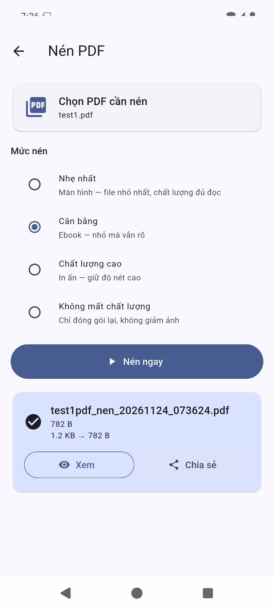
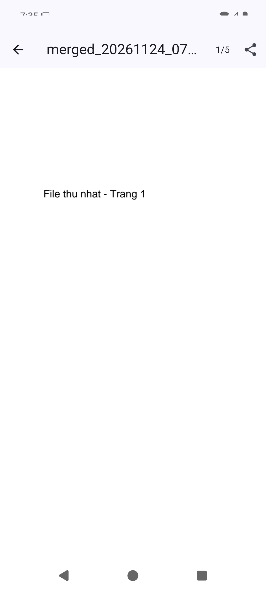

# PDF Utils


**Xử lý mọi vấn đề với file PDF — ngay trên điện thoại, hoàn toàn miễn phí.**

PDF Utils là app Flutter cho Android & iOS gom đầy đủ các công cụ PDF vào một nơi: nén, ghép, tách, sắp xếp, chèn ảnh, ký tên, watermark, scan tài liệu, chuyển ảnh ↔ PDF, khóa/mở khóa, trích xuất text và sửa metadata. Mọi xử lý chạy **on-device** bằng engine Rust của [`pdf_manipulator`](https://pub.dev/packages/pdf_manipulator) — không cần server, không tải file lên đâu cả.


## Mục lục

- [Tính năng](#tính-năng)
- [Ảnh màn hình thật](#ảnh-màn-hình-thật)
- [Kiến trúc](#kiến-trúc)
- [Công nghệ & thư viện](#công-nghệ--thư-viện)
- [Cài đặt & chạy](#cài-đặt--chạy)
- [Quyền truy cập](#quyền-truy-cập)
- [Giấy phép](#giấy-phép)

## Tính năng

| Công cụ | Mô tả |
|---|---|
| **Nén PDF** | Giảm dung lượng với 4 mức: Nhẹ nhất (72ppi/q60), Cân bằng (150ppi/q75), Chất lượng cao (300ppi/q85), Không mất chất lượng (lossless) |
| **Ghép PDF** | Nối nhiều PDF thành một, sắp thứ tự trước khi ghép |
| **Tách PDF** | Chia theo mỗi N trang / từng trang / giới hạn MB mỗi file |
| **Sắp xếp trang** | Kéo-thả đổi thứ tự, xoay 90°, xóa trang — có thumbnail preview |
| **Chèn ảnh** | Đặt ảnh lên trang PDF: chọn trang, góc đặt, kích thước %, độ mờ |
| **Ký tên** | Vẽ chữ ký trên pad, đặt vào PDF như ảnh chèn |
| **Watermark** | Đóng dấu chữ lên trang: nội dung, cỡ chữ, màu, góc, độ mờ, lớp trên/dưới |
| **Scan → PDF** | Quét tài liệu bằng camera (ML Kit document scanner), fallback chụp ảnh thường |
| **Ảnh → PDF** | Tạo PDF từ nhiều ảnh; trang theo ảnh / A4 / Letter, fit contain/cover |
| **PDF → Ảnh** | Xuất từng trang ra PNG, chọn DPI 72–300 |
| **Khóa / Mở khóa** | Đặt mật khẩu (AES) hoặc gỡ mật khẩu PDF |
| **Trích xuất text** | Lấy toàn bộ text ra file `.txt`, copy nhanh |
| **Metadata** | Sửa tiêu đề, tác giả, chủ đề, từ khóa của PDF |
| **Xem PDF** | Đọc PDF trong app (flutter_pdfview), đếm trang, chia sẻ |

**100% FREE** — không quảng cáo, không giới hạn, không cần tài khoản, xử lý hoàn toàn trên máy.

## Ảnh màn hình thật

Chụp từ Android emulator chạy build debug thật:

| Ghép PDF | Kết quả ghép (5 trang, đúng thứ tự) |
|---|---|
|  |  |

| Nén PDF (1.2 KB → 782 B) | Chèn ảnh (tùy chọn) | Kết quả chèn ảnh |
|---|---|---|
|  |  |  |

| Xem PDF trong app |
|---|
|  |

## Kiến trúc

```
lib/
├── main.dart              # MaterialApp, light/dark theme
├── engine.dart            # PdfEngine — wrapper mỏng quanh pdf_manipulator (Rust engine)
├── files.dart             # outputs dir, file picker, image picker, content:// resolver
├── widgets.dart           # PickTile / RunButton / ResultCard / ErrorBanner
├── home_screen.dart       # Grid 14 công cụ + danh sách "File đã tạo"
├── viewer_screen.dart     # Xem PDF trong app
└── screens/               # Một màn hình cho mỗi công cụ
    ├── compress_screen.dart
    ├── merge_screen.dart
    ├── split_screen.dart
    ├── pages_screen.dart        # sắp xếp / xoay / xóa trang với thumbnail
    ├── stamp_screen.dart        # chèn ảnh
    ├── sign_screen.dart         # signature pad → chèn ảnh
    ├── watermark_screen.dart
    ├── scan_screen.dart         # ML Kit scan + fallback camera
    ├── images_to_pdf_screen.dart
    ├── pdf_to_images_screen.dart
    ├── protect_screen.dart      # khóa / mở khóa
    ├── text_screen.dart         # trích xuất text
    └── metadata_screen.dart
```

Mọi file kết quả nằm ở `<Documents>/pdf_utils/` và xuất hiện trong mục **File đã tạo** trên màn hình chính — Xem / Mở / Chia sẻ trực tiếp.

## Công nghệ & thư viện

- **[pdf_manipulator](https://pub.dev/packages/pdf_manipulator) 6.0.0** — engine Rust chạy off-main-thread: merge, split, compress, rewrite (xoay/sắp xếp/xóa trang, watermark, image stamp, metadata), mã hóa AES, render bitmap, trích text.
- **[flutter_pdfview](https://pub.dev/packages/flutter_pdfview)** — xem PDF trong app.
- **[doc_scanner_kit](https://pub.dev/packages/doc_scanner_kit)** — quét tài liệu (Google ML Kit); có fallback chụp ảnh.
- **[file_picker](https://pub.dev/packages/file_picker)** / **[image_picker](https://pub.dev/packages/image_picker)** — chọn file / ảnh / camera.
- **[share_plus](https://pub.dev/packages/share_plus)** / **[open_file](https://pub.dev/packages/open_file)** — chia sẻ & mở kết quả.
- **[permission_handler](https://pub.dev/packages/permission_handler)** — quyền camera.

Tất cả thư viện đều mã nguồn mở (MIT/BSD) và miễn phí.

## Cài đặt & chạy

Yêu cầu: Flutter ≥ 3.47 (Dart 3.13), Android SDK 37 (do `permission_handler` yêu cầu), Xcode cho iOS.

```bash
git clone <repo>
cd pdf-utils
flutter pub get

# Android
flutter build apk --debug        # hoặc flutter run với device/emulator

# iOS (trên macOS)
cd ios && pod install && cd ..
flutter build ios --no-codesign  # hoặc flutter run trên simulator
```

`pdf_manipulator` tự tải binary engine đã build sẵn (~25 MB) qua build hook — không cần cài Rust.

## Quyền truy cập

| Quyền | Dùng cho |
|---|---|
| Camera | Scan tài liệu, chụp ảnh |
| Photo library (iOS) | Chọn ảnh |

App không cần quyền storage đặc biệt — file chọn qua SAF/photo picker, file kết quả trong thư mục riêng của app.

## Giấy phép

Mọi tính năng miễn phí. Mã nguồn phát hành theo MIT License.
